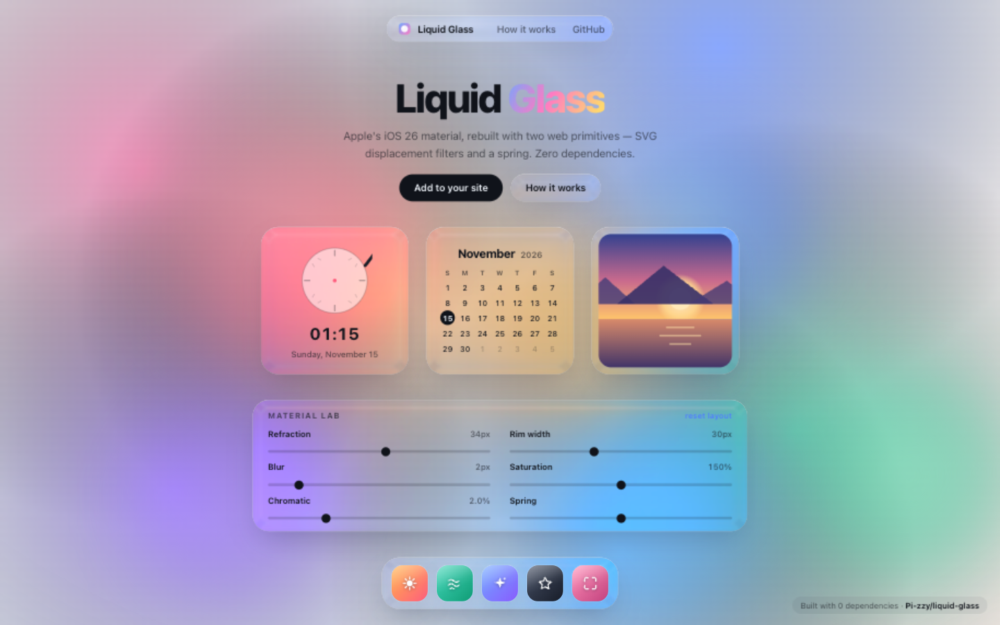
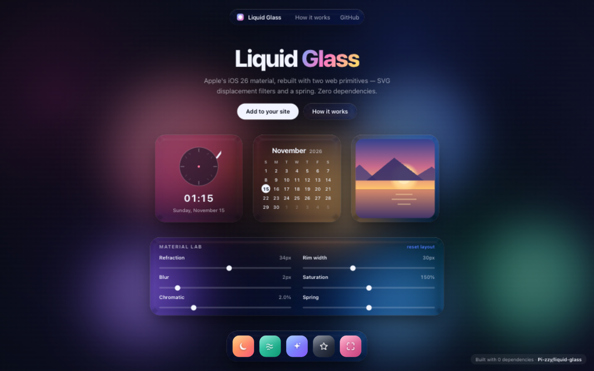

<div align="center">

# Liquid Glass

**Apple's iOS 26 Liquid Glass material, rebuilt with two web primitives —
SVG displacement filters and a spring. Zero dependencies, one file.**

[Live demo](https://pi-zzy.github.io/liquid-glass/) ·
[中文文档](README.zh-CN.md) ·
[How it works](#how-it-works)

`MIT` · `~9 KB` · `0 dependencies`

</div>

---

<p align="center">
  
</p>
<p align="center">
  
</p>

The rim of every surface really refracts what's behind it — background pixels
are pulled from beyond the edge and compressed into it, the way thick glass
bends light. Under that: chromatic aberration on the rim, a pointer-following
specular sheen, and spring physics with elastic snap-back. Everything runs on
the compositor; there is no WebGL and no canvas copy of the backdrop.

## Quick start

Drop in the script and mark any element with `data-liquid-glass`:

```html
<script src="liquid-glass.js"></script>

<div data-liquid-glass data-radius="24" data-refraction="34" data-blur="2">
  Anything inside stays interactive.
</div>
```

Or drive it from JavaScript:

```js
const glass = new LiquidGlass(document.querySelector('#card'), {
  radius: 'auto',     // corner radius, 'auto' reads your CSS border-radius
  refraction: 34,     // max edge displacement, px
  edgeWidth: 30,      // width of the refraction band, px
  blur: 2,            // backdrop blur, px
  saturate: 1.5,      // backdrop saturation
  brightness: 1.04,
  chromatic: 0.02,    // RGB rim fringing (0 = off)
  draggable: true,    // spring-physics drag with elastic snap-back
  stiffness: 220,     // lower = softer, jelly-ier
  damping: 24         // lower = more bounce
});
```

Every option is live: `glass.set({ refraction: 60, blur: 8 })` updates
instantly, geometry changes rebuild the displacement map on the next frame.

| Method | What it does |
| --- | --- |
| `glass.set(options)` | Update options at runtime |
| `glass.refresh()` | Force a full rebuild (after size changes) |
| `glass.reset()` | Spring the element back to its home position |
| `glass.destroy()` | Remove the effect and restore the DOM |
| `LiquidGlass.for(el)` | Find the instance behind an element |
| `el` event `lg:release` | Fired on the host when a drag ends |

## How it works

```
rounded-rect SDF ─▶ displacement map (R/G = direction, 128 = neutral)
                       │
                       ▼
        <feImage> ─▶ <feDisplacementMap> ─▶ backdrop-filter: url(#filter)
                       │
             chromatic mode: 3 passes at slightly different scales,
             isolated per channel and recombined with screen()
```

1. A rounded-rectangle **signed distance field** is rasterized to a small
   canvas. For each pixel we compute the distance to the rim and its outward
   normal, shaped by a smoothstep profile that peaks at the edge and fades
   inward. The vector is packed into the R and G channels (128 = no shift).
2. The PNG feeds an inline SVG `feImage → feDisplacementMap`. Because the
   vectors point outward, the filter **samples background content from beyond
   the rim** and compresses it into the edge — the convex-lens look.
3. `chromatic` runs the displacement three times at slightly different scales,
   isolates R/G/B with `feColorMatrix` and recombines with `feBlend mode="screen"`
   (`color-interpolation-filters="sRGB"` keeps the recombination lossless).
4. The filter is applied with CSS `backdrop-filter: url(#…)`, so the browser
   refracts the real backdrop every frame — no copies, no WebGL, no event
   listeners on scroll or resize beyond one `ResizeObserver`.
5. Draggable elements chase the pointer through a **damped harmonic
   oscillator**, and on release the fling velocity carries into the spring
   that pulls them home — that's the elastic overshoot.

Rim light, depth shadow and the pointer-following sheen are plain CSS layers,
so they composite for free.

### Browser support

`backdrop-filter: url(#svg-filter)` — real refraction — is currently a
Chromium feature (Chrome, Edge, Arc, Brave, Opera). Firefox and Safari
automatically fall back to classic blur + saturate glass (the library probes
support and downgrades itself); everything else, including the physics, works
everywhere.

## Files

```
liquid-glass.js    the library (~9 KB, zero dependencies, MIT)
index.html         demo page
style.css          demo styles
demo.js            demo wiring (clock, calendar, controls, dock)
docs/              screenshots
```

The demo page is the documentation for the tuning knobs — drag a widget, flip
the presets in the dock, and watch the rim respond.

## Credits

- Apple, for the Liquid Glass design language introduced at WWDC 2025.
- [shuding/liquid-glass](https://github.com/shuding/liquid-glass) — the
  SVG-displacement approach this library generalizes.
- [rdev/liquid-glass-react](https://github.com/rdev/liquid-glass-react) —
  early interactive exploration.

## License

[MIT](LICENSE)
