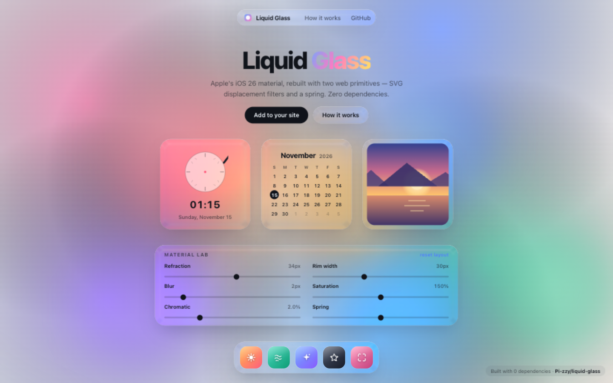

<div align="center">

# Liquid Glass

**苹果 iOS 26 的"液态玻璃"材质，用两个 Web 原语复刻 —— SVG 位移滤镜 + 弹簧物理。
零依赖，单文件。**

[在线演示](https://pi-zzy.github.io/liquid-glass/) ·
[English](README.md)

`MIT` · `~9 KB` · `0 依赖`

</div>

---

<p align="center">
  
</p>

每一块玻璃的边缘都在**真实折射**背后的内容 —— 边缘处的背景像素被从轮廓之外
拉入并压缩，和厚玻璃弯折光线的方式一致。在此之上还有：边缘的色散（RGB 分离）、
跟随指针的镜面高光、带回弹的弹簧拖拽。全部在合成器上运行，没有 WebGL，
也不会拷贝背景画布。

## 快速上手

引入脚本，给任意元素加上 `data-liquid-glass`：

```html
<script src="liquid-glass.js"></script>

<div data-liquid-glass data-radius="24" data-refraction="34" data-blur="2">
  内部内容保持可交互。
</div>
```

或者用 JS API：

```js
const glass = new LiquidGlass(document.querySelector('#card'), {
  radius: 'auto',     // 圆角半径，'auto' 会读取元素的 CSS border-radius
  refraction: 34,     // 边缘最大位移，px
  edgeWidth: 30,      // 折射环带宽，px
  blur: 2,            // 背景模糊，px
  saturate: 1.5,      // 背景饱和度
  chromatic: 0.02,    // 边缘色散强度（0 = 关闭）
  draggable: true,    // 弹簧拖拽，松手弹回
  stiffness: 220,     // 越小越软
  damping: 24         // 越小回弹越多
});
```

所有参数都支持运行时修改：`glass.set({ refraction: 60, blur: 8 })` 立即生效；
几何参数变化会在下一帧自动重建位移贴图。

| 方法 | 说明 |
| --- | --- |
| `glass.set(options)` | 运行时更新参数 |
| `glass.refresh()` | 强制完整重建（尺寸变化后） |
| `glass.reset()` | 弹回初始位置 |
| `glass.destroy()` | 移除效果并还原 DOM |
| `LiquidGlass.for(el)` | 取某个元素背后的实例 |
| 宿主元素事件 `lg:release` | 拖拽结束时触发 |

## 实现原理

```
圆角矩形 SDF ─▶ 位移贴图（R/G = 方向向量，128 = 中性）
                    │
                    ▼
     <feImage> ─▶ <feDisplacementMap> ─▶ backdrop-filter: url(#filter)
                    │
         色散模式：三个缩放略有差异的位移通道，
         各自隔离 R/G/B 后用 screen() 重组
```

1. 把圆角矩形的**有向距离场**栅格化到一张小 canvas：每个像素计算到边缘的
   距离和朝外的法线，用 smoothstep 曲线塑形——边缘最强、向内衰减到零，
   向量打包进 R/G 通道（128 = 不位移）。
2. 这张贴图喂给内联 SVG 的 `feImage → feDisplacementMap`。因为向量朝外，
   滤镜会**从轮廓之外采样背景**并压缩进边缘 —— 这就是凸透镜观感。
3. `chromatic` 用三个略有差异的缩放各跑一次位移，`feColorMatrix` 隔离出
   R/G/B，再用 `feBlend mode="screen"` 重组（`color-interpolation-filters`
   必须设为 `sRGB` 才不会发灰）。
4. 滤镜通过 CSS `backdrop-filter: url(#…)` 应用，浏览器每帧实时折射真实
   背景 —— 无拷贝、无 WebGL，也只需要一个 `ResizeObserver`。
5. 可拖拽元素由**阻尼谐振子**追踪指针，松手时投掷速度会传入拉它回家的
   弹簧 —— 这就是弹性回弹的来源。

边缘高光、深度阴影和指针高光是普通 CSS 图层，合成器免费处理。

### 浏览器支持

`backdrop-filter: url(#svg-filter)`（真实折射）目前是 Chromium 系的能力
（Chrome、Edge、Arc、Brave、Opera）。Firefox 和 Safari 会自动降级为经典的
模糊 + 提饱和毛玻璃（库内部探测支持度并自行切换）；物理引擎等其余功能则
全平台可用。

## 文件

```
liquid-glass.js    核心库（~9 KB，零依赖，MIT）
index.html         演示页
style.css          演示样式
demo.js            演示逻辑（时钟、日历、控制台、Dock）
docs/              截图
```

演示页本身就是调参文档 —— 拖一拖组件，在 Dock 里切换预设，看边缘如何响应。

## 鸣谢

- Apple —— WWDC 2025 发布的 Liquid Glass 设计语言。
- [shuding/liquid-glass](https://github.com/shuding/liquid-glass) —— 本库所
  推广的 SVG 位移方案的先行者。
- [rdev/liquid-glass-react](https://github.com/rdev/liquid-glass-react) ——
  早期交互式探索。

## 许可

[MIT](LICENSE)
